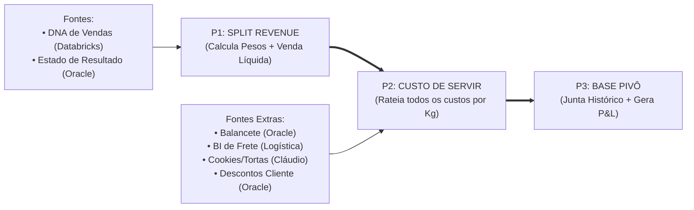

# Resumo Executivo: Projeto Automatização Pivô — FP&A (Planejamento Financeiro)

## 1. Objetivo
Migrar e automatizar no **Databricks** o fluxo de consolidação das 3 planilhas principais de Planejamento Financeiro (**Split Revenue → Custo de Servir → Base Pivô**), eliminando cópias manuais (`SOMASES`/rateios braçais) e o travamento do Excel por excesso de histórico (dados desde 2022/2023).

---

## 2. Fluxograma Atual (Simples e Direto)

**Legenda das Planilhas:**
* **P1 (`Split Revenue`):** 1ª planilha do processo. Recebe a receita bruta do DNA de Vendas, converte os volumes (dúzias, kg, toneladas) e desconta devoluções/promoções do Oracle para chegar na **Venda Líquida (*Ventas Netas*)**.
* **P2 (`Custo de Servir`):** 2ª planilha (intermediária). Recebe os dados da **P1** e faz o rateio (`SOMASES` proporcional ao peso em Kg) de todos os custos da fábrica (mão de obra, ingrediente, embalagem, custo fixo e frete) por Planta, Cliente e SKU.
* **P3 (`Base Pivô`):** 3ª planilha (**Base Mãe** final). Consolida o resultado da **P2** junto com o Budget e o histórico (desde 2022/2023), gerando a tabela dinâmica final do **P&L (DRE)** para a diretoria.

---

## 3. Cenário Atual (As 3 Planilhas e suas Dores)

| Ordem | Planilha | O que faz hoje | Fontes que alimentam | Principais Problemas |
| :--- | :--- | :--- | :--- | :--- |
| **1º (P1)** | **Split Revenue** | Recebe vendas brutas, converte unidades (dúzias/kg/ton) e deduz devoluções/descontos proporcionalmente por planta até chegar na **Venda Líquida (*Ventas Netas*)**. | • **DNA de Vendas** (Databricks) • **Estado de Resultado** (Oracle) | Oracle não tem abertura por Kg/Fábrica/Cliente; DNA de Vendas não tem devoluções nem descontos. União é feita na mão. |
| **2º (P2)** | **Custo de Servir** | A planilha mais complexa (*"Frankenstein"*). Pega o Split Revenue e faz o rateio (`SOMASES` por Kg) de todos os custos (MOD, utilidades, ingredientes, embalagem, frete) por Planta, Cliente e SKU. | • **Split Revenue (P1)** • **Balancete** (Oracle) • **BI Frete de Venda BQ** (Logística) • **Planilha do Cláudio** (Cookies/Tortas) • **Descontos Clientes** (Oracle) | Exige renomear clientes manualmente (ex: Sams Club, Alvarenga) para o `SOMASES` não quebrar; junta 5 fontes diferentes no braço. |
| **3º (P3)** | **Base Pivô** | **Base Mãe**. A aba *Master* recebe a colagem do Custo de Servir (junto com histórico 2022/2023 e Budget) e atualiza a tabela dinâmica do **P&L**. | • **Custo de Servir (P2)** | Arquivo gigante; trava o Excel constantemente; alto risco de corromper e perder todo o histórico. |

---

## 4. Cenário Esperado (Estratégia "De Trás para Frente")

Ficou acordado dividir a entrega em fases (MVPs), começando do final do fluxo (mais simples e rápido de entregar valor para a diretoria) até chegar na automação completa das origens:

* **Fase 1 (MVP 1 — Visualização Rápida no App Databricks):**
  * Subir a **Base Pivô (P3)** para o Databricks App (similar ao que já foi feito no projeto VCM, onde a Jéssica sobe a base consolidada).
  * Disponibilizar visualização rápida (incluindo visão P&L e filtro por Planta) sem travar no Excel para o time e diretoria (João).
* **Fase 2 (Automação do Split Revenue - P1):**
  * Ler o **DNA de Vendas** direto do Databricks, aplicar as fórmulas das colunas amarelas (peso/dúzias/toneladas) e cruzar com o **Estado de Resultado** (Oracle no Databricks, validando o tempo de atualização D-1) para gerar a Venda Líquida automaticamente.
* **Fase 3 (Automação do Custo de Servir - P2):**
  * Automatizar os rateios por Kg no Databricks cruzando **Balancete (Oracle)**, **BI de Frete** e regras de **Cookies/Tortas**, eliminando o `SOMASES` e o de-para manual de nomes de clientes.

---

## 5. Ações Imediatas para Iniciar o Projeto

1. **Envio dos Arquivos (Jéssica / Patrícia):** Compartilhar cópia ou acesso de leitura às 3 planilhas (**Split Revenue**, **Custo de Servir** e **Base Pivô**).
2. **Validação do Fluxo (Renan):** Enviar o fluxograma no grupo da reunião (renomeado para *Automatização Pivô - FP&A / Planejamento Financeiro*) para confirmação da Jéssica e Patrícia.
3. **Abertura da US / Chamado (Diego / Patrícia):** Abrir a User Story do **MVP 1** (visualização da Pivô no App lendo a base delas) e estruturar o backlog das próximas fases.
4. **Mapeamento Técnico no Databricks (Renan / Daniel):** Inspecionar as fórmulas das planilhas recebidas e localizar as tabelas correspondentes do **Oracle** (Estado de Resultado e Balancete) e do **DNA de Vendas** dentro do Databricks.

